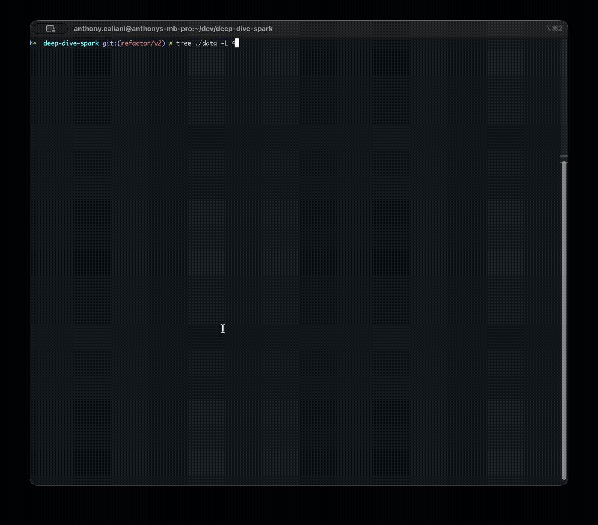

# Kwik-E-Chain

> Part of the [Kwik-E-Mart Universe](../README.md). See there for the inspiration and the other poc.


Scala and Spark pipeline that validates the DonutCoin (DONU) transaction ledger and routes each row to success, error and debug Delta tables.

## Quick Start

```sh
# All commands below run from this folder
cd pocs/kwik-e-chain

# Download the known-users reference data (kafka-in-docker's Simpsons cast list)
mkdir -p data/bronze
curl -o data/bronze/users.csv \
  https://raw.githubusercontent.com/avcaliani/kafka-in-docker/refs/heads/main/scripts/users.csv

# Build the image
docker compose build

# Start the container
docker compose up -d

# Generate the mock DonutCoin transactions dataset
docker compose exec spark python3 scripts/generate_donu_transactions.py

# Run the job (builds & runs)
docker compose exec spark scripts/run.sh

# When you're done
docker compose down
```

<details>
<summary>Pipeline Logs 🎥</summary>



</details>

<br />

<details>
<summary>Local Development 👇</summary>

Tests and formatting run locally, not inside the container.  
Requires JDK 21 and sbt installed on your machine.

```sh
cd pocs/kwik-e-chain

# Build the project
sbt clean compile package

# Run the tests
sbt test

# Format the code
sbt scalafmtAll
```

</details>

## Related Links

- [Apache Spark: Official Website](https://spark.apache.org)
- [Delta Lake: Official Website](https://delta.io)
- [SBT Commands](https://alvinalexander.com/scala/sbt-how-to-compile-run-package-scala-project)
- [kafka-in-docker: Simpsons cast reference data](https://github.com/avcaliani/kafka-in-docker)
