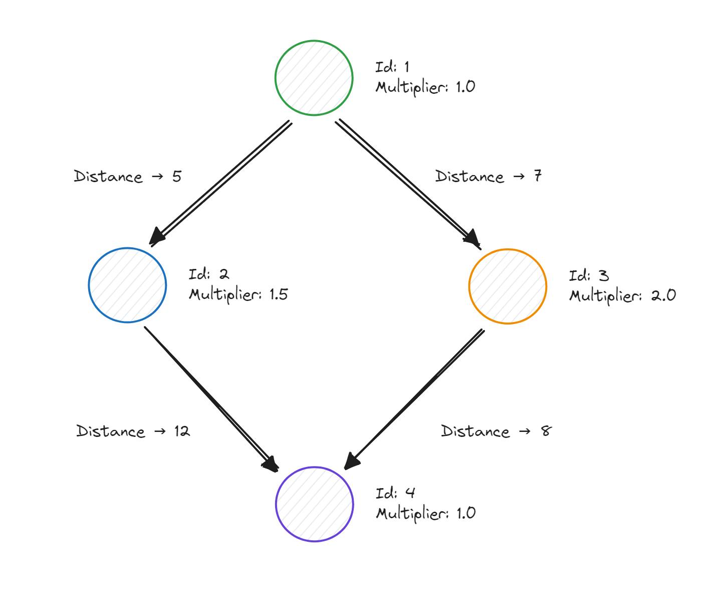
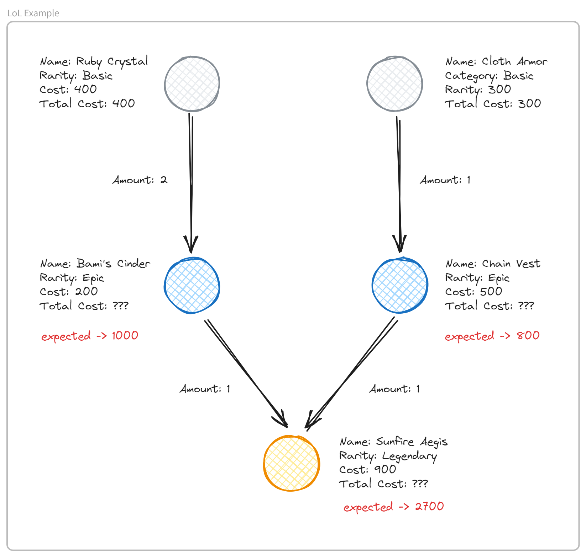

# GraphX

Two GraphFrames challenges on small graphs: distances per node, and the total cost of a League of Legends item (Pregel).

## How to run

Needs JDK 21, [uv](https://docs.astral.sh/uv/) and internet access (the GraphFrames jar is fetched from Maven on the first run).

```bash
cd snippets/graphx/
uv run python distances.py
uv run python lol_items.py
```

Each script asserts its own expected result.

## Example

### Distances

For each node, the sum of `distance (edge) * multiplier (vertex)`. Edges count on the node they arrive at.



```text
+---+----------+--------------+
| id|multiplier|total_distance|
+---+----------+--------------+
|  1|       1.0|           0.0|
|  2|       1.5|           7.5|
|  3|       2.0|          14.0|
|  4|       1.0|          20.0|
+---+----------+--------------+
```

Node 4: `12.0 * 1.0 + 8.0 * 1.0 = 20.0`.

### LoL Items

`total_cost = cost + sum(component total_cost * amount)`. A "Basic" item has no components, so its `total_cost` is its `cost`.



```text
+-------------+---------+----+-----------------+-------------------+----------+
|id           |rarity   |cost|_pregel_is_active|previous_items_cost|total_cost|
+-------------+---------+----+-----------------+-------------------+----------+
|Ruby Crystal |Basic    |400 |true             |NULL               |400       |
|Cloth Armor  |Basic    |300 |true             |NULL               |300       |
|Sunfire Aegis|Legendary|900 |true             |1800               |2700      |
|Bami's Cinder|Epic     |200 |true             |800                |1000      |
|Chain Vest   |Epic     |500 |true             |300                |800       |
+-------------+---------+----+-----------------+-------------------+----------+
```

The diagrams are editable in [`graphs.excalidraw`](.docs/graphs.excalidraw).

## References

- [GraphFrames: Pregel](https://graphframes.io/04-user-guide/10-pregel.html)
- [GraphFrames: Python API](https://graphframes.io/api/python/)
- [Apache Spark: GraphX Programming Guide](https://spark.apache.org/docs/latest/graphx-programming-guide.html)
- [Medium: Introdução ao Spark GraphX e GraphFrames](https://medium.com/data-hackers/introdu%C3%A7%C3%A3o-ao-spark-graphx-e-graphframes-9b10089f2e7f)
- [Stanford: GraphX + Pregel](https://stanford.edu/~rezab/classes/cme323/S16/notes/Lecture16/Pregel_GraphX.pdf)
- [GeeksforGeeks: sum of nodes per level of a tree](https://www.geeksforgeeks.org/calculate-sum-of-all-nodes-present-in-a-level-for-each-level-of-a-tree/)
- [LoL Wiki: Sunfire Aegis](https://leagueoflegends.fandom.com/wiki/Sunfire_Aegis)
